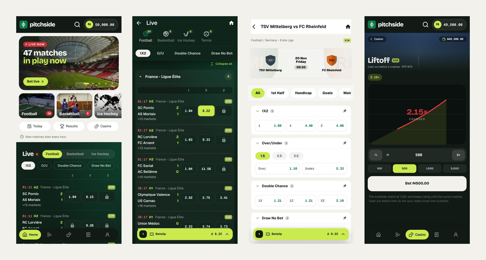
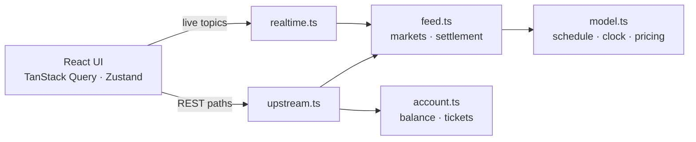

# Pitchside

A mobile sportsbook and casino that runs entirely on a match simulation. About 50 matches are in play at any time across football, basketball, ice hockey and tennis. Prices move with the score and the clock, and bets settle when the final whistle goes. Everything uses play money.

**Live:** https://pitchside-app-alpha.vercel.app (log in with the demo account on the login screen)



[Watch the 60-second demo](docs/media/pitchside-demo.mp4)

## How it works

There's no backend. A deterministic engine inside the app works out the whole sporting world from the current time: which matches exist, what minute each one is in, the score, and a price for every market. Two people opening the site at the same moment see the same matches and the same scores.

The engine answers the same API paths and live-update topics the app was originally built against, so the UI, the betslip and the live-update layer work as they would with a real sportsbook API.



More detail:

- [Case study](docs/case-study.md): the problem, the approach and the results
- [Architecture](docs/architecture.md): request flow, live updates, folder map
- [The match engine](docs/engine.md): scheduling, scoring, pricing, settlement and casino maths
- [Decisions and trade-offs](docs/decisions.md)
- [Photo credits](docs/credits.md)

## Features

- **Sports:** football (six competitions), basketball, ice hockey and tennis, with new matches every hour.
- **Live betting:** prices that react to goals and time, a short suspension after each goal, and locked prices once an outcome is decided.
- **Betslip:** singles, accumulators and system bets, booking codes, and price checks before placement. Price rises are accepted automatically; drops ask first.
- **Casino:** Liftoff, Spot Kick, Dice Duel and Hi-Lo, each with its return-to-player figure shown.
- **Wallet:** play-money top-ups and withdrawals, plus a transaction history.

## Stack

Next.js 16 (App Router) · React 19 · TypeScript · Tailwind CSS v4 · TanStack Query v5 · Zustand v5 · Vitest

## Running it

```bash
npm install
npm run dev      # http://localhost:3000
npm test
npm run build
```

No environment variables are needed.

## Quality

- Lighthouse (mobile): accessibility 100, best practices 100, SEO 100. Performance is 75–80 on sport and casino pages and 50–65 on the home page, where the engine and live feed share the main thread.
- 149 unit tests, including the engine and the betslip.

All teams, players and competitions are fictional. All photos are used under the Unsplash License.
