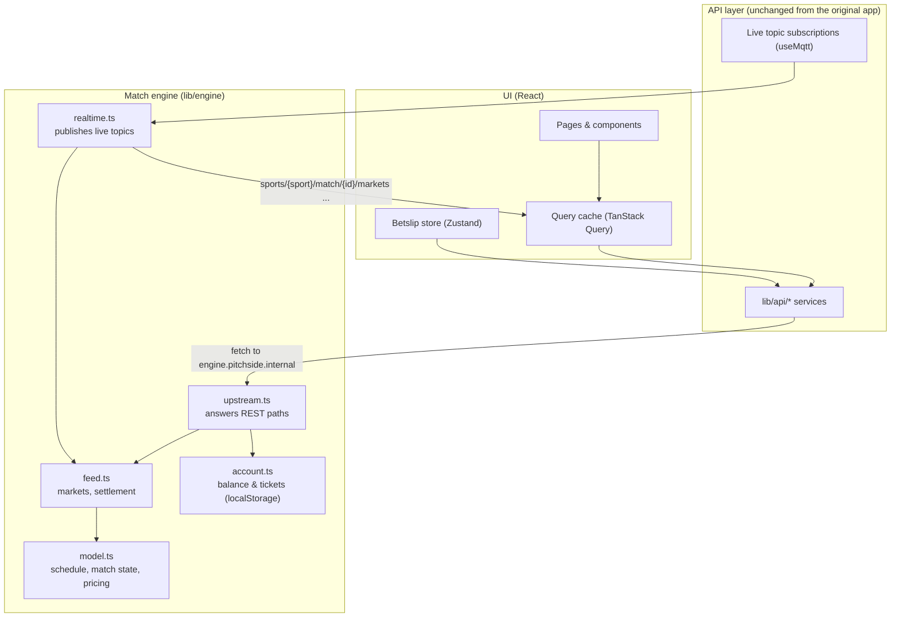
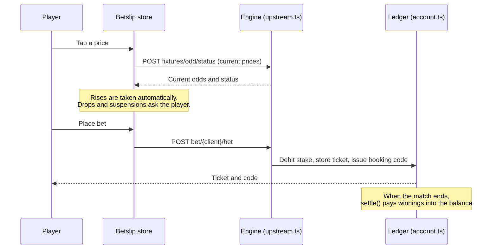

# Architecture

Pitchside is a Next.js 16 app (App Router, React 19, TypeScript, Tailwind CSS v4). There is no separate backend. A match engine inside the app answers every request the UI makes.

## Layers

### How requests reach the engine

The API layer was written for a real service, and it still calls URLs on a single host, `engine.pitchside.internal`.

- **In the browser,** `lib/engine/install.ts` wraps `window.fetch`. Requests to that host are answered by `upstream.ts`, and everything else goes to the network as usual.
- **In server routes and server components,** the same requests go through `engineFetch`, which calls `upstream.ts` directly.

Because both sides compute from the same clock, a page rendered on the server and the live updates that follow in the browser agree without sharing any state.

### Live updates

The original app subscribed to MQTT topics such as `sports/1/match/123/markets`. `realtime.ts` keeps that contract:

1. Components subscribe to topics for the matches on screen.
2. Every 3 seconds the engine reprices half of the subscribed matches and publishes a message only when a price, status or score has actually changed.
3. `useSportsbookRealtimeBridge` patches those messages into the query cache, so the visible rows and the betslip update in place.

The feed starts once the page has finished loading, so the first render isn't competing with it.

## Placing a bet

## Folder map

| Path | What's there |
|---|---|
| `lib/engine/catalog.ts` | Sports, competitions and clubs (all fictional) |
| `lib/engine/model.ts` | Schedule, match clock and score, pricing model |
| `lib/engine/feed.ts` | Feed-shaped fixtures and markets, settlement rules |
| `lib/engine/upstream.ts` | Answers the REST paths the app calls |
| `lib/engine/realtime.ts` | Publishes live topics |
| `lib/engine/account.ts` | Play-money balance, tickets, casino stakes, wallet |
| `lib/casino/` | Casino game catalogue and maths |
| `components/` | UI, grouped by area (home, live, fixtures, betting, casino, wallet) |
| `store/couponStore.ts` | The betslip |
| `public/photos/` | Self-hosted photography (see [credits](credits.md)) |
